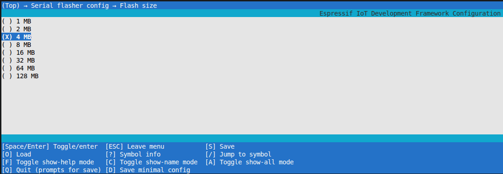

# sensor_terminal_rs485

## Linux 开发环境搭建

编译所需基础软件包安装：

```Bash
sudo apt-get install git wget flex bison gperf python3 python3-pip python3-venv cmake ninja-build ccache libffi-dev libssl-dev dfu-util libusb-1.0-0
```

使用国内源获取`esp-idf`:

```Bash
mkdir -p ~/.esp && cd ~/.esp
wget https://dl.espressif.com/github_assets/espressif/esp-idf/releases/download/v5.5.1/esp-idf-v5.5.1.zip
chmod +x esp-idf-v5.5.1.zip
unzip esp-idf-v5.5.1.zip
mv esp-idf-v5.5.1 esp-idf
```

配置`python`的国内源（`[13]`）：

```Bash
wget http://fishros.com/install -O fishros && . fishros
```

安装工具：

```Bash
cd ~/.esp/esp-idf
export IDF_GITHUB_ASSETS="dl.espressif.cn/github_assets"
./install.sh all
```

添加环境变量，将下面内容添加到`.bashrc`文件中：

```Bash
alias get-idf='. $HOME/.esp/esp-idf/export.sh'
```

## 编译源码

### 获取源码

```bash
git clone https://github.com/wxnlP/sensor_terminal_rs485.git
```

若下载失败，可以尝试国内加速：

```bash
git clone https://gh-proxy.org/https://github.com/wxnlP/sensor_terminal_rs485.git
```

### 编译选项

程序分两个模式：

1. 气象站（源码默认）
2. lora（需要做修改）

>  ⚠：**HUAWEI_CLOUD** 宏定义为调试使用，非真实需要。

---

**气象站模式**

修改`main`下的`CMakeLists.txt`为：

```cmake
idf_component_register(
    SRCS "main.c"
         "gpio/led.c"
         "uart/uart.c"
        #  "lora/transceiver.c"
        #  "lora/mqtt_lora.c"
        #  "lora/device_num.c"
         "mqtt/mqtt_task.c"
         "wifi/wifi_ap.c"
         "wifi/wifi_station.c"
         "tasks/main_tasks.c"
         "wx_sta/wx_sta.c"
         "wx_sta/wx_app.c"
         "wx_sta/mqtt_wx.c"
         "screen/screen.c"
    INCLUDE_DIRS ".")


    
target_compile_definitions(${COMPONENT_LIB} PRIVATE 
     WX_STATION
    #  HUAWEI_CLOUD
)
```

---

**lora模式**

修改`main`下的`CMakeLists.txt`为：

```cmake
idf_component_register(
    SRCS "main.c"
         "gpio/led.c"
         "uart/uart.c"
         "lora/transceiver.c"
         "lora/mqtt_lora.c"
         "lora/device_num.c"
         "mqtt/mqtt_task.c"
         "wifi/wifi_ap.c"
         "wifi/wifi_station.c"
         "tasks/main_tasks.c"
        #  "wx_sta/wx_sta.c"
        #  "wx_sta/wx_app.c"
        #  "wx_sta/mqtt_wx.c"
        #  "screen/screen.c"
    INCLUDE_DIRS ".")


    
target_compile_definitions(${COMPONENT_LIB} PRIVATE 
    #  WX_STATION
    #  HUAWEI_CLOUD
)
```

### 编译烧录

刷新 esp-idf 环境（新终端必须做一次）：

```bash
get-idf
```

修正 flash 配置：

```bash
idf.py menuconfig
```

选中`serial flasher config` ，修改`Flash Size`大小为 4MB。



编译：

```bash
idf.py build
```

烧录：

```
idf.py flash
```

如果自动识别端口失败，尝试显式指定端口：

```bash
# <port>替换为你的端口，ttyACM0/ttyUSB0
idf.py flash -p <port> 
```

烧录完成后，可以调用监控器查看日志：

```bash
# 打开串口监控
idf.py monitor
```

> **使用**`Ctrl+]`关闭监控。

## 气象站设备配置

### Wi-Fi 与 MQTT

在 [`wifi_station.c`](main/wifi/wifi_station.c#L15-L16) 中，将 `WIFI_SSID` 和 `WIFI_PASSWORD` 分别改为该设备现场使用的 Wi-Fi 名称和密码。

在 [`mqtt_wx.c`](main/wx_sta/mqtt_wx.c#L24-L36) 修改以下参数。保持 `HUAWEI_CLOUD` 注释，连接和主题参数修改 `#else` 分支中的值。

| 参数 | 填写内容 |
| --- | --- |
| `MQTT_URI` | MQTT 服务器地址和端口，例如 `mqtt://192.168.1.100:1883`。 |
| `MQTT_USERNAME`、`MQTT_PASSWD` | 服务器为该设备分配的用户名和密码。 |
| `MQTT_CLIENT_ID` | 该设备的客户端 ID；接入同一服务器的设备不能使用相同的 ID。 |
| `MQTT_PUBLLISH_TOPPIC` | 气象数据发布主题，当前为 `weather/sensor`。 |
| `MQTT_SUBSCRIBE_TOPIC` | 采集间隔设置主题，当前为 `wx_sta/time`。 |
| `MQTT_SERVICE_ID` | 上报服务标识，当前为 `wx_station`；按后台要求填写。 |
| `DEFAULT_UPLOAD_TIME_INTERVAL` | 两轮采集之间的默认等待时间，当前为 60 秒；改为 5 分钟可写成 `(5 * M)`。 |

### 硬件接口

#### UART2：气象传感器和显示屏

UART2 通过 RS485 连接温湿度、风速、风向、光照和降雨传感器，也用于向气象站显示屏发送数据。

| 参数 | 当前值 | 修改位置 |
| --- | --- | --- |
| ESP32 侧接线 | TX：GPIO5；RX：GPIO4；RS485 方向控制：GPIO21 | 在 [`uart.c`](main/uart/uart.c#L13-L19) 修改 `UART2_TX_PIN`、`UART2_RX_PIN`、`RS485_DR_PIN`。 |
| 波特率 | 9600 | 在 [`main.c`](main/main.c#L29) 修改 `WxInit(9600)` 的参数，填写外设使用的波特率。 |
| 传感器地址 | 温湿度 `0x01`、风速 `0x02`、风向 `0x03`、光照 `0x04`、降雨 `0x05` | 在 [`main.c`](main/main.c#L69-L88) 修改各采集请求的地址参数，填写对应传感器实际配置的地址。 |
| 显示屏控件编号 | 以 `INDEX_*` 的现有定义为准 | 屏幕控件编号不同时，在 [`screen.h`](main/screen/screen.h#L6-L15) 修改对应的 `INDEX_*`。 |

## LoRa 收发设备配置

### Wi-Fi 与 MQTT

在 [`wifi_station.c`](main/wifi/wifi_station.c#L15-L16) 中，将 `WIFI_SSID` 和 `WIFI_PASSWORD` 分别改为该设备现场使用的 Wi-Fi 名称和密码。

在 [`mqtt_lora.c`](main/lora/mqtt_lora.c#L24-L38) 修改以下参数。保持 `HUAWEI_CLOUD` 注释，连接和主题参数修改 `#else` 分支中的值。

| 参数 | 填写内容 |
| --- | --- |
| `MQTT_URI` | MQTT 服务器地址和端口，例如 `mqtt://192.168.1.100:1883`。 |
| `MQTT_USERNAME`、`MQTT_PASSWD` | 服务器为该设备分配的用户名和密码。 |
| `MQTT_CLIENT_ID` | 该设备的客户端 ID；接入同一服务器的设备不能使用相同的 ID。 |
| `MQTT_PUBLLISH_TOPIC_SOIL`、`MQTT_PUBLLISH_TOPIC_321` | 土壤、三合一传感器数据的发布主题，当前分别为 `soil/sensor`、`3/sensor`。 |
| `MQTT_SUBSCRIBE_TOPIC` | 采集间隔设置主题，当前为 `soil3/time`。 |
| `MQTT_SERVICE_ID_SOIL`、`MQTT_SERVICE_ID_321` | 上报服务标识，当前分别为 `soil_sensor`、`321_sensor`；按后台要求填写。 |
| `DEFAULT_UPLOAD_TIME_INTERVAL` | 两轮采集之间的默认等待时间，当前为 60 秒；改为 5 分钟可写成 `(5 * M)`。 |

### 硬件接口

#### UART2：LoRa 收发器

UART2 通过 RS485 连接 LoRa 收发器，用于读取远端土壤和三合一传感器的数据。

| 参数 | 当前值 | 修改位置 |
| --- | --- | --- |
| ESP32 侧接线 | TX：GPIO5；RX：GPIO4；RS485 方向控制：GPIO21 | 在 [`uart.c`](main/uart/uart.c#L13-L19) 修改 `UART2_TX_PIN`、`UART2_RX_PIN`、`RS485_DR_PIN`。 |
| 波特率 | 115200 | 在 [`transceiver.c`](main/lora/transceiver.c#L161) 修改 `UartInit(2, 115200)` 的第二个参数，填写收发器使用的波特率。 |
| 传感器轮询地址 | 土壤和三合一各为 `1～32`（循环条件为 `< 33`） | 在 [`main.c`](main/main.c#L47-L65) 分别修改两段循环的起始地址和上限。地址超出 `1～32` 时，还需调整 [`device_num.c`](main/lora/device_num.c#L23-L59) 的编号范围。 |
| 单次等待超时 | 2000 毫秒 | 在 [`main.c`](main/main.c#L47-L65) 修改对应循环中 `pdMS_TO_TICKS(2000)` 的参数。 |

### 传感器上报编号

LoRa 收发设备根据**传感器类别和轮询地址**生成编号，并把它作为字符串写入 MQTT 上报数据的 `properties.index`。例如，通信地址 `1` 对应的土壤传感器上报编号为 `ss2025040105001`。编号用于后台识别点位，不会改变传感器的通信地址。

#### 地址与点位的对应关系

两类传感器各自使用 `1～32` 的地址。每两个相邻地址组成一个点位：`1/2 → 001`、`3/4 → 002`，依此类推，`31/32 → 016`。末尾点位序号固定为三位，不足三位补零。同一对地址中，奇数和偶数代表不同的安装位置或深度：

| 传感器类别 | 奇数地址 | 偶数地址 | 编号格式 |
| --- | --- | --- | --- |
| 土壤传感器 | 5 cm 深度，深度码 `05` | 20 cm 深度，深度码 `20` | `ss` + 8 位日期 + 2 位深度码 + 3 位点位序号 |
| 三合一传感器 | 棚边，前缀 `ps` | 棚中，前缀 `pc` | `ps` 或 `pc` + 8 位日期 + 2 位位置码（当前为 `00`）+ 3 位点位序号 |

以当前日期码 `20250401` 为例：

| 通信地址 | 点位序号 | 土壤传感器上报编号 | 三合一传感器上报编号 |
| --- | --- | --- | --- |
| `1` | `001` | `ss2025040105001`（5 cm） | `ps2025040100001`（棚边） |
| `2` | `001` | `ss2025040120001`（20 cm） | `pc2025040100001`（棚中） |
| `3` | `002` | `ss2025040105002`（5 cm） | `ps2025040100002`（棚边） |
| `4` | `002` | `ss2025040120002`（20 cm） | `pc2025040100002`（棚中） |

#### 如何修改编号

- **改日期码、深度码或位置码**：在 [`device_num.c`:7–15](<main/lora/device_num.c#L7-L15>) 修改 `SENSOR_NAME_DATE`、`SS_DEPTH_5CM`、`SS_DEPTH_20CM` 或 `PCPS_POS_CODE`。日期格式为 `YYYYMMDD`，是固定配置，不是采集日期。保持日期 8 位、深度码和位置码各 2 位；当前编号为 15 个字符，上报代码的缓冲区另留 1 字节存放字符串结束符。
- **改地址与点位的对应关系**：如果现场布置不是按奇偶地址配对，在 [`device_num.c`:23–81](<main/lora/device_num.c#L23-L81>) 修改 `generate_ss_name()` 或 `generate_pspc_name()`。如果只是增减轮询地址，修改前面所列的轮询范围。
- **已接入后台的设备**：修改编号规则后，同一传感器可能会上报新的 `index`。如果后台按编号绑定点位，需同步更新后台的点位配置。

